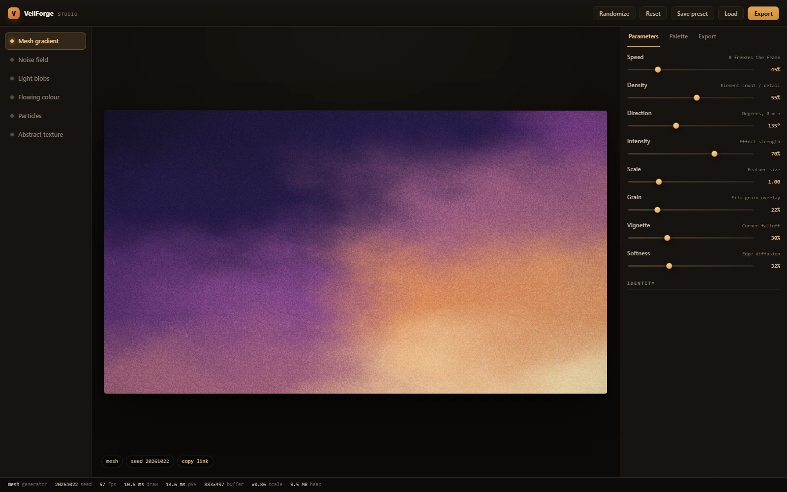
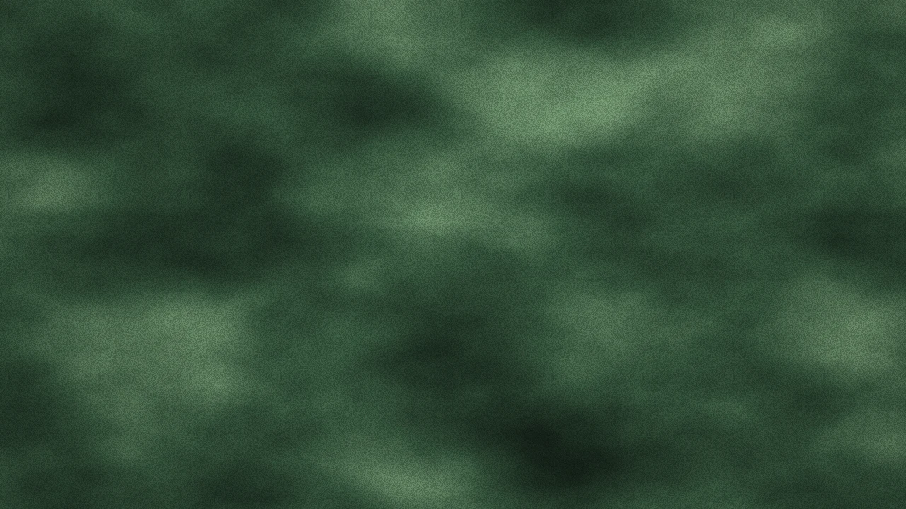
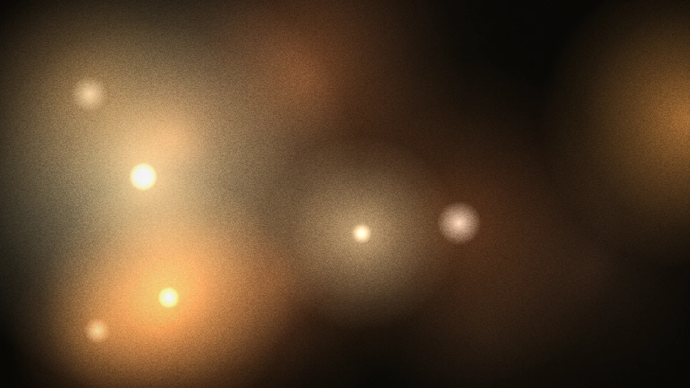
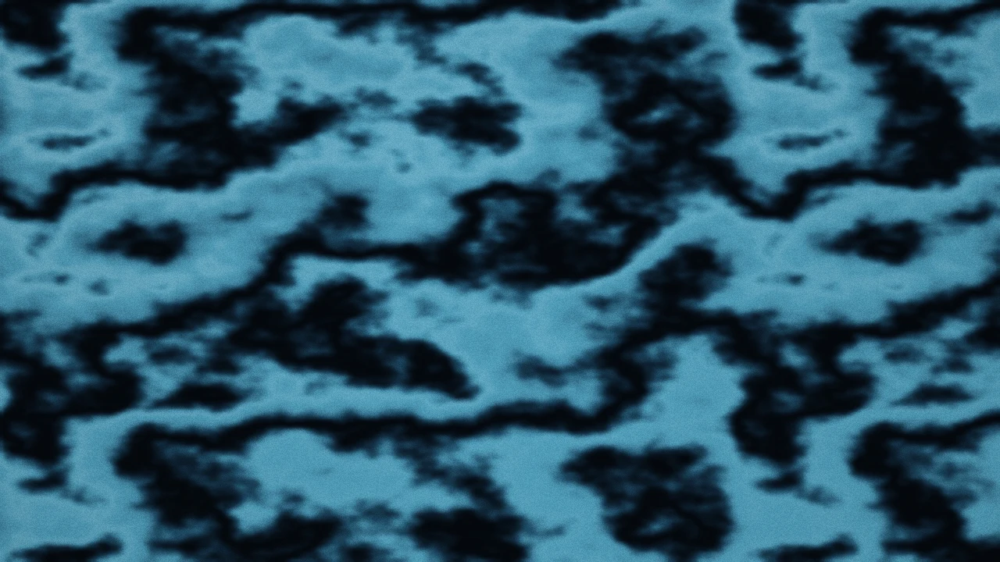
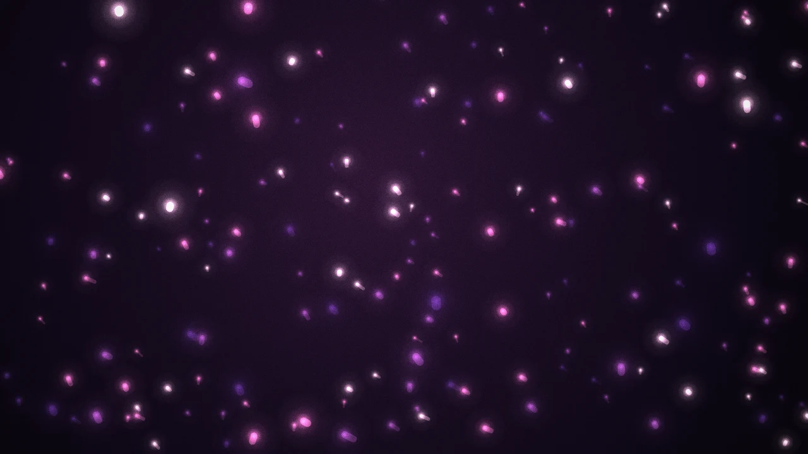
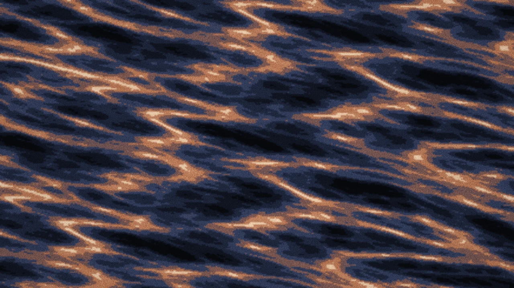
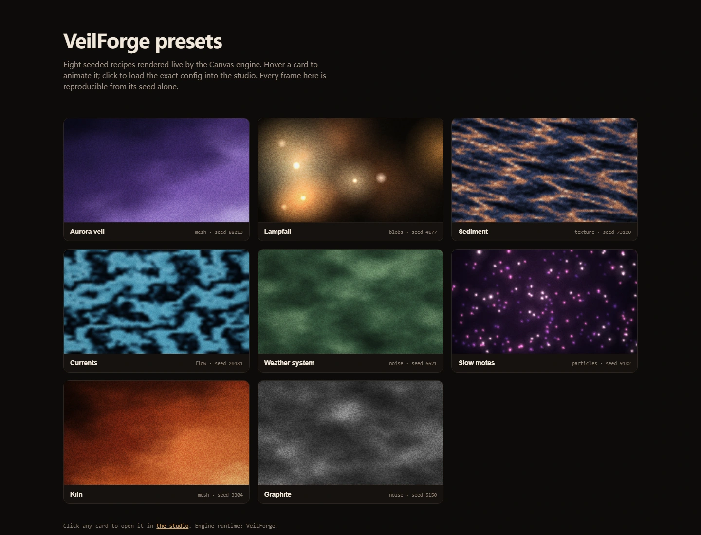

# VeilForge studio

**A procedural background generator for the web.** Six generators, one parameter
model, four export targets — and a verification harness that measures whether the
exports actually look like the preview instead of asserting that they do.

Zero runtime dependencies. Canvas2D only (no WebGL), so it runs on machines and
browsers where shaders do not.



```
mesh gradient · dynamic noise · light blobs · flowing colour · particles · abstract texture
```

---

## Why this exists

The category is crowded with single-purpose tools. What is missing is not another
mesh-gradient toy; it is a tool that treats a background as a **recipe** and can
hand that recipe to four different runtimes — CSS, SVG, Canvas, raster — while
telling you honestly how much fidelity each one buys.

Every generator here is a pure function of `(config, time)`. Same seed, same
frame, forever. That single constraint is what makes export verification possible:
the harness renders the preview and the export at the same timestamp and diffs them.

## Quick start

```bash
# 1. Modular dev server (ES modules need http, not file://)
node tools/serve.mjs          # → http://127.0.0.1:4317/

# 2. Single-file build (double-clickable, no server)
npm run build                 # → dist/veilforge.html, dist/demo.html
```

Open `dist/veilforge.html` for the studio, `dist/demo.html` for the preset gallery.
Both work from `file://` with no server and no network.

Live: **https://llinok111.github.io/veilforge-studio/** (studio) ·
**/demo.html** (gallery)

### Embed an exported background

```html
<script src="veilforge-runtime.js"></script>
<canvas id="bg"></canvas>
<script>
  VeilForge.mount('#bg', { generator: 'mesh', palette: ['#0b0d17', '#7d3f8c', '#f6e2b3'] });
</script>
```

`veilforge-runtime.js` (58 KB unminified, no dependencies) is the same engine the
studio runs — not a re-implementation, which is why the Canvas export is
pixel-identical rather than merely similar.

---

## The parameter model

Five controls the brief asks for, plus three that separate "generated" from
"designed":

| Control | Range | What it actually does |
|---|---|---|
| `speed` | 0–2 | Time scale. **0 freezes** and removes all animation from CSS/SVG exports. |
| `density` | 0–1 | Element count or field octaves: lattice 2–5 per axis, blobs 4–22, particles 24–304, strata 3–14. |
| `direction` | 0–360° | Drift vector, band normal, strata rotation. Not decorative — it changes geometry. |
| `intensity` | 0–1 | Effect strength: warp depth, gamma, alpha, band warp. |
| `scale` | 0.4–3 | Feature size, mapped inversely to noise frequency. |
| `grain` | 0–1 | Film grain overlay. Kills gradient banding on large fills. |
| `vignette` | 0–1 | Corner falloff. |
| `blur` | 0–1 | Softness. Implemented by lowering the field resolution, not with a blur filter — free, deterministic, and identical in the exported Canvas code. |

Palettes are ordered **dark → light** because each generator maps a scalar field
through the ramp. Get the order wrong and the result looks like mud. Interpolation
happens in **OKLab**, not sRGB, so midpoints stay clean instead of going grey.

## The six generators

| | id | Name | Technique |
|---|---|---|---|
|  | `mesh` | Mesh gradient | Bicubic lattice, smoothstep weights, noise domain warp |
|  | `noise` | Noise field | Two counter-drifting tileable fBm stacks mapped through the palette LUT |
|  | `blobs` | Light blobs | Additive radial gradients (`lighter`), white-hot cores |
|  | `flow` | Flowing colour | Phase-warped band field with a second harmonic |
|  | `particles` | Particles | Analytic motion, cached glow sprites, motion streaks |
|  | `texture` | Abstract texture | Ridged fBm quantised into strata, rotated by `direction` |

*Every frame above is a real render from this engine at the seed printed in
`src/core/presets.js` — `node tools/shots.mjs` regenerates all of them and asserts
each one is not blank before writing.*



Two techniques carry the project:

**Tileable noise in one texture.** `perlin2` takes an explicit period and masks
lattice indices with `& (period - 1)`; every fBm octave doubles its period, so the
whole stack wraps at exactly `u = 1`. That lets the engine precompute one 256²
field and animate by translating UV instead of re-evaluating noise per pixel — the
difference between ~4 ms and ~40 ms a frame. It is also what lets the CSS/SVG
turbulence tiles repeat without a seam.

**Analytic particles.** Position is `wrap(base + velocity · t)`, not an integral.
No accumulator, no hidden state, so the frame at `t = 2.0` is reproducible from the
config alone. Trails are drawn as a segment from `pos(t − Δ)` to `pos(t)` for the
same reason — a fading buffer would make the frame path-dependent and therefore
unverifiable.

## Export targets

| Target | Files | Animation | Fidelity |
|---|---|---|---|
| **CSS** | `.css` + `.html` | `@keyframes` | Approximation — real geometry, no domain warp |
| **SVG** | `.svg` + `.html` | SMIL | High for element generators, tonal for field generators |
| **Canvas / JS** | `.html` + `.js` + `.json` | `requestAnimationFrame` | **Exact** — same engine |
| **PNG / WebP** | image | none | Exact, re-rendered at target resolution |
| **Config** | `.json` + share link | — | Exact round-trip |

Declared fidelity per generator is re-banded from measurement, not aspiration:

| generator | CSS | SVG | measured SSIM (css / svg) |
|---|---|---|---|
| blobs | high | high | 0.79 / 0.76 |
| particles | high | high | 0.83 / 0.83 |
| mesh | medium | medium | 0.67 / 0.65 |
| noise | medium | medium | 0.51 / 0.48 |
| flow | low | low | 0.30 / 0.27 |
| texture | low | low | 0.27 / 0.26 |

The export panel shows that label next to the download button, so nobody ships a
particle field as CSS expecting it to look like the canvas.

### CSS

Positions, counts, radii and palette all come from `layout.js` — the same module
the renderer reads. A blobs export therefore places its 22 light sources exactly
where the canvas placed them; only the blending maths differs. Noise and texture
use `feTurbulence` in an inline SVG data URI, `background-blend-mode: color` to
apply the palette to turbulence luminance, and a tile size derived from the
renderer's actual noise frequency so the feature scale matches.

What CSS cannot do: domain warping, per-particle velocity, and a specific noise
realisation. Those are stated in the export notes rather than papered over.

### SVG

`feTurbulence` + `feComponentTransfer` with `tableValues` sampled from the same
OKLab ramp the canvas uses, so the colour mapping is not an approximation.
`feDisplacementMap` folds flow bands the way the phase warp does. Animation is
SMIL — Chrome, Firefox and Safari all implement it, but it does not honour
`prefers-reduced-motion` inside a standalone file, which the notes say out loud.

### Canvas

The export embeds the flattened engine plus the config as a literal, wrapped in a
single IIFE. Because it is the same `Renderer`, the harness asserts a **pixel hash
match**, and does.

---

## What the harness measured

`verify/verify.mjs` drives headless Chromium and writes `verify/out/report.md`.

```
NODE_PATH=<node_modules with playwright> node verify/verify.mjs     # full sweep
NODE_PATH=... node verify/fidelity.mjs                              # fidelity only, ~6 min
NODE_PATH=... node verify/perf.mjs                                  # frame cost only
NODE_PATH=... node verify/built.mjs                                 # dist/*.html from file://
```

Results from the recorded run (Chromium 149 headless, 1200×675, deviceScaleFactor 1):

**1. Export fidelity — 6 exact, 7 structural, 5 tonal, 0 divergent.**

- Canvas: **6/6 byte-identical** (MAE 0, SSIM 1, matching pixel hash).
- Structural (SSIM and exposure both inside the gate): blobs, particles, mesh,
  and noise/CSS.
- Tonal only: flow and texture in both targets, noise/SVG — same exposure
  (|Δmean| ≤ 0.033) and contrast, different noise realisation.

**2. Determinism — 3/3.** Same seed renders byte-identical frames in separate page
loads; a new seed changes the frame (MAE 12–28).

**3. Structural validity — 6/6.** Every SVG parses through `DOMParser` (25–1081
nodes), every stylesheet parses into 3+ rules, every config round-trips.

**4. Frame cost.** The ablation in the report separates generation from compositing:

| stage | p50 at 1920×1080 |
|---|---|
| generator + vignette + grain, scene only | 2.7 ms |
| + display composite and the readback this harness forces | 27.4 ms |
| environment baseline (clear + upscale blit, no generator) | 6.4 ms |

Sustained animation over a 5-second window lands at 13–21 fps **in headless
software raster**. No quality setting reaches 60 fps there — `quality: medium`
measures 16–48 ms depending on generator (particles 35.5, texture 48.2, blobs 16.1)
because the composite floor does not shrink with the render scale. This is the
environment, not the algorithm: the scene-only row above is 2.7 ms.

The generator is a small fraction of the frame. What dominates is the final
1536×864 → 1920×1080 composite plus a synchronous `getImageData` used to make the
measurement possible at all. On a GPU-composited canvas that composite is a texture
blit; under software raster with a forced readback it costs more than the procedural
work. Both numbers are reported so neither is mistaken for the other.

**5. Bytes shipped.** Canvas 60 KB per export (engine included), SVG 2.4–76 KB,
CSS 1.9–6.3 KB, runtime 58 KB, single-file studio 208 KB.

### Bugs the harness caught

- `feTurbulence` emits a **noisy alpha channel**; compositing it unmodified renders
  the whole noise/texture layer at ~50% opacity. Forcing alpha to 1 moved noise SVG
  from 0.38 to 0.48 SSIM and removed a 0.23 exposure error.
- The renderer paints a **radial base wash** under particles; the SVG and CSS
  exports did not, so they came out at 0.03 mean luminance against a 0.10 reference.
  Adding it took particles to 0.83 SSIM in both targets.
- A local `buildExport()` inside `createApp` **shadowed the imported exporter** of the
  same name, so the export panel silently received `undefined`. ES modules do not
  warn about this — only running the built artefact did.
- Inlined JS containing a literal `</script>` **truncates the host script tag**; the
  single-file build needs `<\/script` escaping.
- `const BUILDERS` declared in both `css.js` and `svg.js` is legal per module and a
  `SyntaxError` once flattened; `tools/bundle.mjs` now fails the build on top-level
  name collisions.

Unit tests are separate and pure (no browser):

```bash
node --test "tests/*.test.mjs"      # 49 tests
```

They cover the maths (OKLab round-trip, noise tiling, LUT monotonicity), the config
contract (clamping, share-link round-trip), layout determinism, and structural
validity of every export. Two real bugs were caught this way: an out-of-range LUT
index that silently blacked out a mesh quadrant, and a share link that scaled
`direction` by 1000 on encode but not back on decode.

---

## Architecture

```
src/
  core/        rng · color (OKLab) · noise (periodic Perlin/fBm) · config · presets
  generators/  layout.js (shared geometry) + one module per generator
  engine/      renderer (clock, DPR, adaptive quality) · field buffers · sprites
  export/      css · svg · canvasjs · raster · json · dispatcher
  ui/          app · controls · dom helpers
  runtime/     entry point for the flattened export bundle
tools/         bundle (ESM flattener) · gen-runtime · build · serve · package
verify/        verify (full) · fidelity · perf · built · ascii · metrics
tests/         node:test suites
```

**`layout.js` is the load-bearing decision.** A seeded RNG stream is sequential, so
copying "six `rng.range()` calls" into a CSS builder produces different numbers the
moment anything is reordered. Computing geometry once and having the renderer and all
exporters read it is the only way "same anchors" stays true over time.

The ESM flattener (`tools/bundle.mjs`) is ~90 lines: walk `import` statements,
topologically sort, strip `export`, refuse to build on a top-level collision. It
exists because two artefacts must be single-file (the standalone demo and the
downloadable runtime) while the source stays readable modules.

## Browser support

| Feature | Used by | Fallback |
|---|---|---|
| Canvas2D | everything | none — hard requirement |
| `imageSmoothingQuality` | upscaling | ignored where absent |
| `pattern.setTransform` | grain offset | feature-detected; unshifted pattern otherwise |
| `mix-blend-mode` | CSS blobs/particles, SVG | degrades to normal blending |
| `background-blend-mode` | CSS noise/texture | degrades to an unblended tint |
| SVG `feTurbulence` / `feDisplacementMap` | SVG noise/flow/texture | static gradients |
| SMIL | SVG animation | static SVG |
| `prefers-reduced-motion` | engine + studio | animation simply plays |

Tested: Chromium 149 headless, deviceScaleFactor 1. Firefox and WebKit are not
installed in the verification environment, so no claim is made about them beyond the
feature list above — every API used is baseline in Firefox 100+ and Safari 16.4+
except the grain pattern transform, which is feature-detected.

## Accessibility

- `prefers-reduced-motion: reduce` freezes the engine at `t = 0` (a real freeze, not a
  CSS override), and the exported Canvas page re-checks it at runtime.
- The preview canvas is `aria-hidden`; the studio is keyboard operable
  (`R` randomise, `E` export, `S` save config, `Space` pause).
- `contrastRatio()` is exported so text over a generated background can be checked
  against 4.5:1.

## Limits, stated plainly

- CSS and SVG exports are **structurally faithful, not identical**. A different noise
  realisation cannot be pixel-matched; the report gives the actual numbers.
- `flow` and `texture` translate worst (SSIM 0.26–0.30): their look *is* the warp, and
  neither CSS nor SVG can warp. The Canvas export is the answer for those two.
- Particles exported to CSS cap at 56 gradients — past that, CSS raster cost outruns a
  canvas. Motion becomes one group translation; per-mote velocity is not expressible
  without JS.
- No WebGL. On very large canvases the software path is the ceiling; the engine adapts
  render scale automatically but will not invent GPU headroom.
- Video export (WebM) is not implemented. `renderStill` + `MediaRecorder` is the
  obvious next step.
- No worker offload. The per-pixel generators run on the main thread; at 1080p they fit
  in a frame, at 4K continuous animation they will not.
- SVG filter graphs are cheap to ship and expensive to raster: a noise/texture page
  takes 0.9–1.2 s to first paint under software raster at 1200×675. Fine for a hero
  background, wrong for a scrolling list of twenty.
- `blur`, `grain` and `vignette` are full-frame composites. In software raster they
  are the frame budget; on a GPU they are noise.

## License

MIT. See `LICENSE`.

## Acknowledgements

The generator taxonomy follows the conventions of the modern background-tool category
(paper-shaders, Creatica, texture-lab, css-mesh, ShaderGradient). This implementation
shares no code with them; the differentiating claim is the export fidelity contract and
the harness that measures it.
